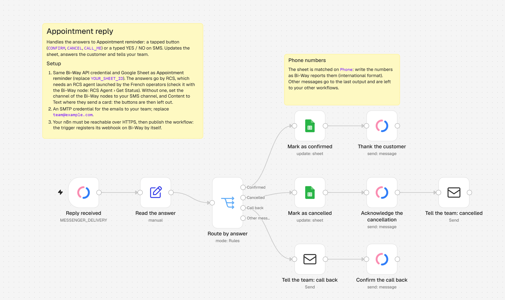

  
  &nbsp;&nbsp;&nbsp;&nbsp;
  

# Bi-Way for n8n

Send SMS, RCS rich messages and emails from [n8n](https://n8n.io/): cards and carousels with images,
suggestion buttons, your verified brand as the sender, and a fallback SMS when a phone cannot receive
RCS.

RCS is the successor of SMS in the phone's messaging app: messages come from your brand's verified
profile, the **RCS agent**, and can show images, cards and buttons. `n8n-nodes-biway-messenger` is the
n8n community package of [Bi-Way](https://www.bi-way.fr/), the messaging platform of Pocket
Communication.

> **RCS is currently available on French mobile operators only** (French phone numbers). For other
> numbers, and for phones that cannot receive RCS, Bi-Way can send an SMS instead, or let your
> workflow decide (see [RCS with your own fallback](#rcs-with-your-own-fallback)).

- [Why Bi-Way in n8n](#why-bi-way-in-n8n)
- [Get an API key](#get-an-api-key)
- [Installation](#installation)
- [Credentials](#credentials)
- [Send your first message](#send-your-first-message)
- [Channels](#channels)
- [Requirements](#requirements)
- [Operations](#operations)
- [Bi-Way Trigger](#bi-way-trigger)
- [RCS with your own fallback](#rcs-with-your-own-fallback)
- [RCS scenarios](#rcs-scenarios)
- [Example workflows](#example-workflows)
- [Compatibility](#compatibility)
- [API documentation and support](#api-documentation-and-support)

## Why Bi-Way in n8n

- **Two-way conversations.** The Bi-Way Trigger starts a workflow when a customer replies or taps a
  suggestion button, and tells you which button. Delivery and read reports arrive the same way, so a
  workflow can follow up on messages that were not delivered or not read.
- **RCS with a safety net.** When a phone cannot receive RCS, Bi-Way sends the fallback SMS of your
  account, an SMS written in the node, or nothing at all so that your workflow decides.
- **The same cards by email.** A card or a carousel can also go by email, laid out by Bi-Way. Its
  buttons open the Bi-Way web chat, where your keyword replies and the Bi-Way Trigger answer as they
  do on RCS.
- **A verified sender.** RCS messages come from your RCS agent: your brand name and logo, verified by
  Google and approved by the mobile operators.
- **Your data stays in France.** Bi-Way is run by Pocket Communication, a French company subject to
  the GDPR, and hosted in France. With a self-hosted n8n, phone numbers and messages only travel
  between your servers and Bi-Way: no third-party automation cloud is involved.

## Get an API key

1. Create your Bi-Way account: [v3.bi-way.fr/signup](https://v3.bi-way.fr/signup). For plans and
   prices, [contact Bi-Way](https://www.bi-way.fr/contact/).
2. In the Bi-Way app, open **Settings › Security › API keys**
   ([v3.bi-way.fr/settings/security](https://v3.bi-way.fr/settings/security)).
3. Click **Create a key**, give it a name (for example `n8n`), and copy the **token** and the
   **secret**. The secret is shown only once.

You can revoke a key at any time from the same page; the workflows that use it then stop working.
The page also lists the **Account key**: it works too, but cannot be revoked, so prefer a key of your
own.

## Installation

- **Self-hosted n8n**: as an owner or admin, open **Settings › Community Nodes › Install**, enter
  `n8n-nodes-biway-messenger` and confirm. See the n8n
  [installation guide](https://docs.n8n.io/integrations/community-nodes/installation/) for the manual
  installation (queue mode, Docker images built in advance).
- **n8n Cloud**: only community nodes verified by n8n can be installed there. This package will be
  available once n8n has verified it.

## Credentials

The **Bi-Way API** credential uses the API key: paste the **token** and the **secret** created in
[Get an API key](#get-an-api-key). Leave **Base URL** unchanged unless Bi-Way support asks you to
change it. n8n tests the key when you save the credential.

## Send your first message

1. Add the **Bi-Way** node to a workflow (search for "Bi-Way", "SMS", "RCS" or "Email").
2. Pick your **Bi-Way API** credential, then **Resource** *Message* and **Operation** *Send*.
3. **Channel**: one of the channels of your account (see [Channels](#channels)), for example *RCS*
   or an SMS channel.
4. **Content** *Text*, **Source** *Raw Message*, and type the **Body**.
5. **Recipient**: a phone number in international format, for example `+33612345678` (an email
   address on an email channel, with a **Subject**).
6. Click **Execute step**. The node returns the `id` of the sending; the status reports of the Bi-Way
   Trigger carry it as `order_id`.

## Channels

The **Channel** list shows the channels enabled on your Bi-Way account, under the names Bi-Way gives
them:

- **RCS**: rich messages (cards, carousels, buttons) to French mobile phones, sent by your RCS agent,
  with a fallback SMS for the phones that cannot receive RCS.
- **SMS**: text only, from the short or long number set up on your account. Whether customers can
  reply depends on that number: ask Bi-Way which of your channels receive replies.
- **Email**: text with attachments, cards and carousels, through the `email` channel (Mailjet) or
  the `email_smtp` channel (your SMTP server).

A channel is enabled on your account by Bi-Way. The node only offers what the chosen channel can
carry: an SMS channel only takes a text.

## Requirements

| What you use | Needs |
|---|---|
| Message › Send, Message › Broadcast | A Bi-Way plan with API access. Channels that need a sender use the default sender of your account unless you pick one. |
| RCS: channel, cards, carousels, buttons, keyword replies, scenarios | Recipients on French mobile operators, and an RCS agent declared by your company and launched by the operators. Declare it on the [RCS declaration form](https://app.bi-way.fr/rcs-registration/); a declaration fee applies. The node's **RCS Agent › Get Status** tells you where it stands. |
| Email channels | The email option of your account, set up by Bi-Way: Mailjet for `email`, SMTP for `email_smtp`. |
| Template, Asset and Contact operations | The matching permissions on your Bi-Way user profile. |
| Bi-Way Trigger | An n8n instance reachable from the internet over HTTPS. |

When something is missing, the node stops with a message that says what to do.

## Operations

| Resource | Operation | What it does |
|---|---|---|
| Message | Send | Sends a text, a card or a carousel to one phone number or email address, written in the node or taken from a template. |
| Message | Broadcast | Sends the same content to phone numbers or email addresses, contacts and contact groups, now or later, optionally in segments. |
| Template | Create | Creates a message template: a subject (used by email), then a text (with RCS buttons if needed), a card or a carousel. Reuses the template with the same title by default. |
| Asset | Upload | Uploads a file to your Bi-Way gallery (2 MB for images and documents, 30 MB for videos). Returns its ID, to show it in a card or attach it to an email. |
| Contact | Create | Creates a contact from the columns of your account. Recognizes an existing contact by the column you pick in **Match On Column** (the phone number by default, or the email address, a customer number…) and, by default, returns it instead of creating a duplicate (or updates it, or stops). |
| Contact | Create Group | Creates a contact group. Reuses the group with the same name by default. |
| Contact | Import File | Imports contacts from a file into a group, in one of the import formats of your account (XLS by default; the CSV format of Bi-Way is tab-separated). The import runs in the background: the node returns the ID of the import task. |
| RCS Agent | Create Keyword Reply | Replies with a template when a customer sends a keyword to your RCS agent, or taps a suggestion button that carries it. Reuses the reply to the same keyword by default. |
| RCS Agent | Get Status | Returns the state of your RCS declaration and of your RCS agent at each operator, and the next step to take. |
| RCS Scenario | Create, Get, Get Many, Activate, Deactivate, Delete | Manages the scenarios of your RCS agent (see [RCS scenarios](#rcs-scenarios)). Create, Get and Get Many return a simplified output unless you turn **Simplify** off. Delete removes the scenario only, not its templates nor its keyword replies. |
| RCS Scenario | Start | Sends the first message of a scenario to a phone number. |

Good to know:

- **Content, then Source**: Send and Broadcast first ask for the **Content** (*Text*, *Card* or
  *Carousel*), then whether you write it in the node (*Raw Message*) or use a *Template*. The
  template list only shows the templates of the chosen content that the channel can carry; any other
  template is refused before sending.
- **Cards and carousels** need an RCS or email channel. A card has an image or a video (from your
  Bi-Way gallery, where it must be public, or from an HTTPS address), a title, a body and 4 buttons
  at most; a carousel shows 2 to 10 cards side by side. An RCS text takes 11 buttons at most. Button
  labels are 25 characters at most. Button kinds: Suggested Reply, Open URL Action, Dial Action and
  View Location Action.
- **Emails** written in the node need a **Subject**; an email sent from a template takes the
  template's subject. The body of a text email is HTML. Attachments are files of your Bi-Way gallery:
  upload a file of the workflow first with **Asset › Upload**.
- **Recipients**: phone numbers in international format, or email addresses on email channels.
  Addresses typed in Broadcast are not saved as contacts.
- **Personalization tags** work for contacts and contact groups: write a contact column between
  brackets, for example `Hello [surname]` for the first name of a Bi-Way contact.
- **Picking items**: templates, contact groups, scenarios and gallery files are chosen **From List**
  (search by name or ID) or **By ID**, for example to map an ID returned by an earlier node.
- **Dates** are sent to Bi-Way in the Europe/Paris time zone, to the minute. A date without time zone
  is read in the time zone of the workflow. Bi-Way refuses dates in the past.
- **Status reports**: Broadcast asks for delivery and read reports by default (option **Status
  Reports**). They reach the Bi-Way Trigger as *Message Status Updated* events.
- **No duplicates when a workflow runs again**: Template › Create, Contact › Create Group, Contact ›
  Create and RCS Agent › Create Keyword Reply reuse the existing item by default (field **If …
  Already Exists**). Names are compared ignoring case and surrounding spaces; contacts on the exact
  value of their Match On Column. *Update It* changes the mapped columns only.
- The node can be used as a tool by AI agents.

## Bi-Way Trigger

The trigger registers its webhook URL on your Bi-Way account when the workflow is published (activated,
on n8n 1), and removes it when the workflow is unpublished. It adds its URL next to the callback URLs
your account may already have: it never replaces them. **Listen for test event** registers a separate
test URL for as long as n8n listens; it also has to be reachable from the internet (for an n8n on your
computer, use a tunnel and set `WEBHOOK_URL`).

| Event | Starts the workflow when |
|---|---|
| Message Status Updated | A message you sent was delivered, read, refused, clicked or expired, or could not go through RCS. |
| Message Received | A customer sent a message, replied to one of your messages or tapped a suggestion button. |
| Contact Import State Changed | A contact import progressed or ended. |
| RCS Agent State Changed | Your RCS agent changed state at a mobile operator. |
| RCS Capability Check Completed | Bi-Way finished checking which phone numbers can receive RCS. |
| Account State Changed | Your Bi-Way account was enabled or disabled. |

Each event becomes one item.

**Message Received** items carry the customer's phone number (`address`), the name of the contact
when Bi-Way knows it, otherwise the phone number (`sender`), the text (`message`), the `channel`, the
`date`, and `keyword`: the keyword of the button the customer tapped, or `null` for a typed message.
With the **Button Keywords** option, the workflow only starts for the buttons you list.

**Message Status Updated** items carry the `order_id` (the `id` returned by Message › Send or
Broadcast), the `message_id`, the `channel`, the recipient's `address`, the dates `sent_at`,
`delivered_at` and `read_at`, and a `status`:

| `status` | Meaning |
|---|---|
| `sent`, `error` | The message left Bi-Way, or could not. |
| `delivered`, `undelivered`, `rejected` | Delivery report of the operator. |
| `read`, `open`, `click`, … | Read report, for the channels that have one. |
| `unsupported` | RCS was not possible (phone not RCS-capable) and **no SMS was sent**: handle it in your workflow. |
| `expired` | The RCS message was not delivered before its expiry. |

They also carry `fallback`: `"sms"` when a fallback SMS was sent instead of the RCS message, `"none"`
when no SMS was sent, `null` otherwise. When Bi-Way falls back to SMS, an event with
`status: "error"` and `fallback: "sms"` can arrive shortly before the `sent` of the SMS: do not treat
it as final, wait for the delivery report.

Good to know:

- Bi-Way sends the events of the **whole account**, including messages not sent from n8n.
- The webhook URL must be reachable from the internet over **HTTPS**. When n8n runs behind a proxy or
  a tunnel, set the `WEBHOOK_URL` environment variable of n8n.
- The registered URL carries a token derived from the secret of the API key; calls without it are
  refused. If you change the secret of the credential, unpublish the workflow and publish it again.

## RCS with your own fallback

By default, when a phone cannot receive RCS, Bi-Way sends the fallback SMS of your account. To decide
in n8n instead:

1. **Bi-Way** node, **Message › Send** on the RCS channel, with **If the Phone Is Not RCS-Capable**
   set to *Send Nothing*.
2. In another workflow, **Bi-Way Trigger** with the event *Message Status Updated* → **If**
   `{{ $json.status }}` is `unsupported` → **Bi-Way** node, **Message › Send** on an SMS channel to
   `{{ $json.address }}`, or anything else: a call task, a different wording, nothing at all.

## RCS scenarios

A Bi-Way scenario is a conversation driven by RCS buttons: each Suggested Reply button sends a
keyword, and a keyword reply answers it with the next message. Build one from n8n in four steps:

1. **Template › Create** for each step: content *Text*, *Card* or *Carousel*, with buttons of type
   *Suggested Reply*. Each button carries a keyword (for example `CONFIRM`, `CALL_ME`).
2. **RCS Agent › Create Keyword Reply** for each keyword: it sends the template of the next step.
3. **RCS Scenario › Create** with the first template. The scenario appears in the Bi-Way app, where
   you can also edit it.
4. **RCS Scenario › Start** to send the first message to a phone number.

To take over the conversation in n8n, give the last templates Suggested Reply buttons whose keywords
have **no** keyword reply, and catch them with a **Bi-Way Trigger** on *Message Received* with the
**Button Keywords** option. The workflow receives the customer's phone number (`address`) and the
tapped keyword (`keyword`), and can answer with **Message › Send** or run any other action.

## Example workflows

Ready-to-import workflows are in [`examples/`](examples/README.md), with how to import them and the
placeholders to replace. They use n8n's own nodes and the Bi-Way nodes, and send by RCS: without an
RCS agent, switch their Bi-Way nodes to an SMS channel (Content Text instead of Card).

| Workflow | What it does |
|---|---|
| [Appointment reminder](examples/appointment-reminder.json) | Reminds customers of tomorrow's appointments with quick-reply buttons. |
| [Appointment reply](examples/appointment-reply.json) | Handles the buttons tapped on the reminder. |
| [Review request](examples/review-request.json) | Asks for a rating, sends happy customers to your Google reviews and alerts your team about unhappy ones. |
| [Order notifications](examples/order-notifications.json) | Sends an RCS card with a tracking button when a WooCommerce order is completed, with a fallback SMS. |
| [Inbound reply to team inbox](examples/inbound-to-team-inbox.json) | Routes customer replies to the right team by keyword. |
| [Form to welcome message](examples/form-welcome-message.json) | Creates or updates the contact from a form and sends a welcome message. |
| [Weezevent ticket holders](examples/weezevent-ticket-holders.json) | Fetches the new participants of a Weezevent event, saves them as contacts and sends them an RCS message, or an email when the registration form does not ask for their phone number. Needs access to the Weezevent API, which Weezevent grants to its partners. |

## Compatibility

- Tested with n8n 2.45.4, self-hosted. On n8n 1, "publish" and "unpublish" read "activate" and
  "deactivate".
- n8n nodes API version 1, no runtime dependency.
- RCS reaches phones on French mobile operators only; SMS reach the destinations of your Bi-Way plan.

## API documentation and support

- [Bi-Way API documentation](https://services.bi-way.fr/openapi/), for the requests behind each
  operation and the advanced **Extra (JSON)** and **Filters (JSON)** options.
- [RCS declaration form](https://app.bi-way.fr/rcs-registration/)
- [n8n community nodes documentation](https://docs.n8n.io/integrations/#community-nodes)
- Issues and questions about this package:
  [GitHub issues](https://github.com/pocket-communication/n8n-nodes-biway-messenger/issues)
- Bi-Way support: [tech@pocketcommunication.com](mailto:tech@pocketcommunication.com)

A French presentation for bi-way.fr is in [docs/integration-n8n-fr.md](docs/integration-n8n-fr.md).

## License

[MIT](LICENSE.md) © Pocket Communication
