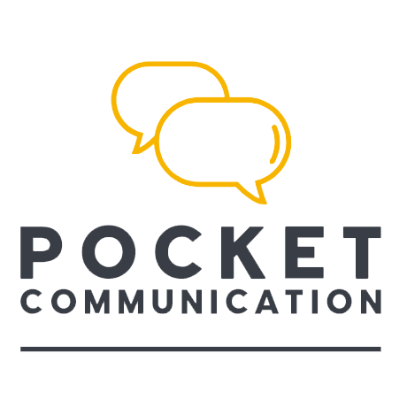

  
  &nbsp;&nbsp;&nbsp;&nbsp;
  

# n8n-nodes-biway-messenger

[n8n](https://n8n.io/) community nodes for [Bi-Way](https://www.bi-way.fr/), the messaging platform of
Pocket Communication: send SMS, RCS and email messages, manage message templates, gallery files and
contact groups, and start workflows when Bi-Way sends an event (status reports, replies, imports).

- [Installation](#installation)
- [Prerequisites](#prerequisites)
- [Credentials](#credentials)
- [Bi-Way node](#bi-way-node)
- [Bi-Way Trigger](#bi-way-trigger)
- [Example workflows](#example-workflows)
- [Compatibility](#compatibility)
- [Resources](#resources)

## Installation

Follow the [installation guide](https://docs.n8n.io/integrations/community-nodes/installation/) in the
n8n community nodes documentation, and install the package `n8n-nodes-biway-messenger`.

## Prerequisites

This package does not create Bi-Way accounts nor subscribe to plans: you need an existing Bi-Way
account. What each operation requires:

| Operation | Requires |
|---|---|
| Every operation | An API key of your Bi-Way account (see [Credentials](#credentials)). |
| Message › Send, Message › Broadcast | A Bi-Way plan with API access ([sign up](https://v3.bi-way.fr/signup) or ask Bi-Way support). Only the channels enabled on your account work; channels that need a sender use the default sender of your account unless you pick one. |
| Sending on the RCS channel, RCS › Create Keyword Reply | An RCS agent declared by your company and launched by the mobile operators. Declare it on the [RCS declaration form](https://app.bi-way.fr/rcs-registration/) or in your [Bi-Way RCS settings](https://v3.bi-way.fr/settings/chatbot); a declaration fee applies. Check its state with **RCS Agent › Get Status**. |
| Template › Create, Asset › Upload, Contact › Create Group, Contact › Import File | The matching permissions on your Bi-Way profile. |
| Bi-Way Trigger | An n8n instance reachable from the internet over HTTPS. |

When a prerequisite is missing, the node stops with an explicit message telling what to do.

## Credentials

The **Bi-Way API** credential uses an API key, made of a **token** and a **secret**:

1. Sign in to Bi-Way and open **Settings › Security › API keys**
   ([v3.bi-way.fr/settings/security](https://v3.bi-way.fr/settings/security)).
2. Click **Create a key**, give it a name (for example `n8n`) and copy the token and the secret. The
   secret is shown only once.
3. In n8n, create a **Bi-Way API** credential and paste the token and the secret. Leave **Base URL**
   unchanged unless Bi-Way support asks you to change it.

You can revoke the key at any time from the same page; the workflows using it then stop working.
The key of your account (shown as "account key") is also visible in the former Bi-Way application,
under **Mon compte**.

## Bi-Way node

| Resource | Operation | What it does |
|---|---|---|
| Message | Send | Sends a message to one recipient (phone number or email address). Returns the ID of the sending. |
| Message | Broadcast | Sends a message to addresses, contacts and contact groups, now or later, optionally in segments. |
| Template | Create | Creates a message template (text, HTML, media or RCS rich cards). |
| Asset | Upload | Uploads a file to your Bi-Way gallery (2 MB for images and documents, 30 MB for videos). Returns its ID, to attach it to messages and templates. |
| Contact | Create Group | Creates a contact group. |
| Contact | Import File | Imports contacts from a CSV, XLS or XLSX file into a group. The import runs in the background: the node returns the ID of the import task. |
| RCS Agent | Create Keyword Reply | Replies with a template when a customer sends a keyword to your RCS agent. |
| RCS Agent | Get Status | Returns the state of your RCS declaration and of your RCS agent at each operator, and the next step to take. |

Notes:

- **Dates** are sent to Bi-Way in the Europe/Paris time zone, to the minute. A date without time zone
  is read in the time zone of the workflow. Bi-Way refuses dates in the past.
- **Broadcast** collects delivery and read reports by default (option **Status Reports**). They reach
  the Bi-Way Trigger as "Message Status Updated" events.
- **Personalization tags** of Bi-Way work for contacts and contact groups. Addresses typed in the node
  are not saved as contacts.
- The node can be used as a tool by AI agents.

## Bi-Way Trigger

The trigger registers its webhook URL on your Bi-Way account when the workflow is activated, and removes
it when the workflow is deactivated. It adds its URL next to the callback URLs your account may already
have: it never replaces them.

| Event | Starts the workflow when |
|---|---|
| Message Status Updated | A message you sent was delivered, read, refused or clicked. |
| Message Received | A customer sent a message or replied to one of your messages. |
| Contact Import State Changed | A contact import progressed or ended. |
| RCS Agent State Changed | Your RCS agent changed state at a mobile operator. |
| RCS Capability Check Completed | Bi-Way finished checking which phone numbers can receive RCS. |
| Account State Changed | Your Bi-Way account was enabled or disabled. |

Each event becomes one item. Good to know:

- Bi-Way sends the events of the **whole account**, including messages not sent from n8n.
- The webhook URL must be reachable from the internet over **HTTPS**. When n8n runs behind a proxy or a
  tunnel, set the `WEBHOOK_URL` environment variable of n8n.
- The registered URL carries a token derived from the secret of the API key; calls without it are
  refused. If you change the key of the credential, deactivate and reactivate the workflow.

## Example workflows

**1. Confirm an order by SMS.** Shop trigger (for example WooCommerce › Order Created) → **Bi-Way ›
Message › Send**: channel *SMS*, recipient `{{ $json.billing.phone }}`, body
`Hello {{ $json.billing.first_name }}, your order {{ $json.number }} is confirmed.`

**2. Send a monthly newsletter to a group.** Schedule Trigger (first Monday of the month, 9:00) →
**Bi-Way › Message › Broadcast**: channel *Email*, content *Template* (your newsletter template),
recipients *Contact Group* "Newsletter", option **Status Reports** *All*.

**3. Route customer replies to your team.** **Bi-Way Trigger** with the event *Message Received* →
IF (`{{ $json.message }}` contains `STOP`) → otherwise Slack › Send Message with
`{{ $json.sender }}: {{ $json.message }}`.

**4. Import contacts from a spreadsheet, then message them.** Google Drive › Download File (XLSX) →
**Bi-Way › Contact › Import File** (format *XLSX*, group "Leads", duplicate handling *Deduplicate Within
the Group*) → in another workflow, **Bi-Way Trigger** with *Contact Import State Changed* → **Bi-Way ›
Message › Broadcast** to the group "Leads".

## Compatibility

Uses the n8n nodes API version 1 and has no runtime dependency.

## Resources

- [Bi-Way API documentation](https://services.bi-way.fr/openapi/)
- [RCS declaration form](https://app.bi-way.fr/rcs-registration/)
- [Sign up to Bi-Way](https://v3.bi-way.fr/signup)
- [n8n community nodes documentation](https://docs.n8n.io/integrations/#community-nodes)
- Support: [tech@pocketcommunication.com](mailto:tech@pocketcommunication.com)

## License

[MIT](LICENSE.md) © Pocket Communication
