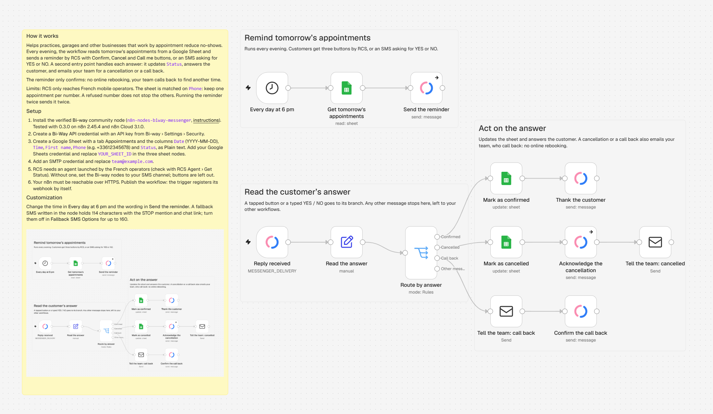
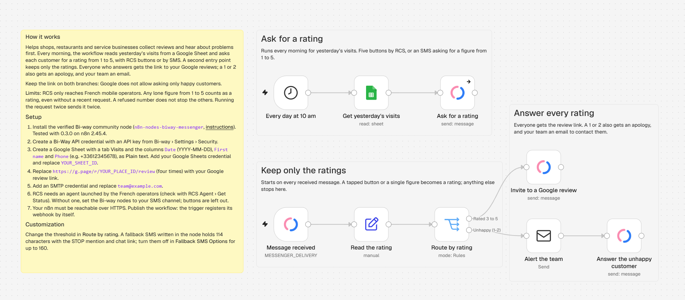
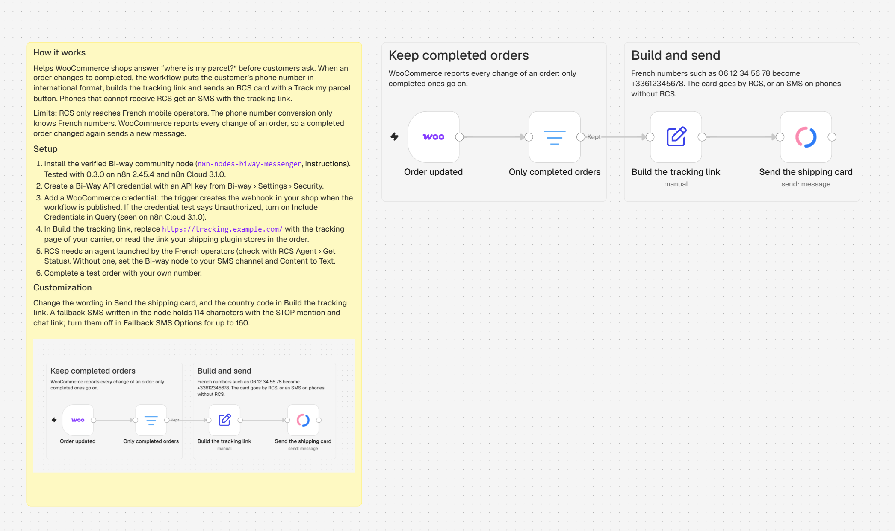
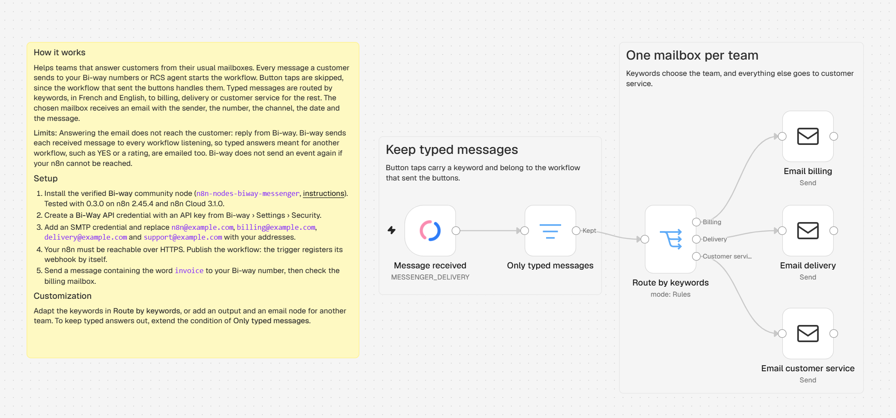
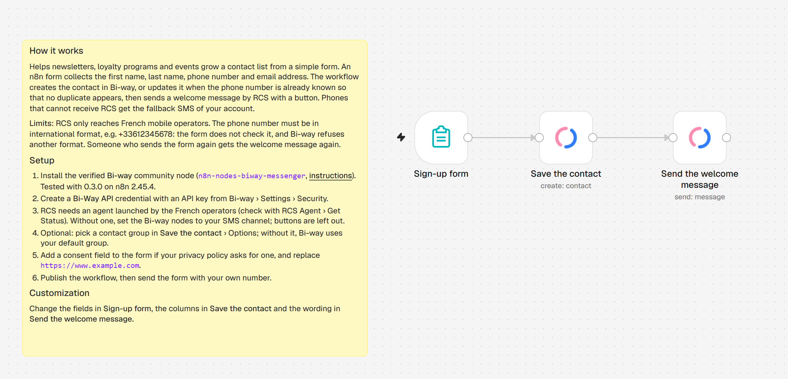
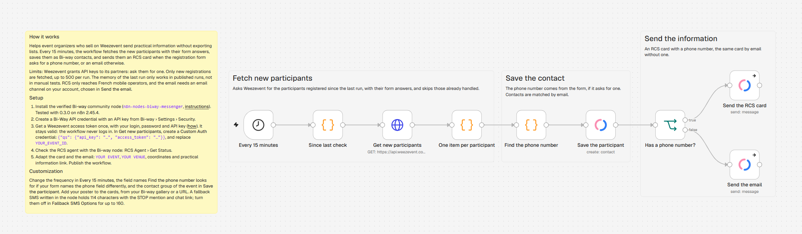

# Example workflows

Ready-to-import n8n workflows built with the Bi-way nodes and n8n's own nodes only. Each one opens
with a yellow note: how it works, its limits, its setup. White notes explain the main steps.

## Import a workflow

1. Install the `n8n-nodes-biway-messenger` community package (see the [main README](../README.md#installation)).
2. Open the JSON file on GitHub and download it (**Download raw file**), then in a new n8n workflow
   open the **⋯** menu › **Import from File…** (or copy the raw content and paste it on the canvas).
3. Select your credentials in the nodes that ask for one: **Bi-Way API**, and Google Sheets, SMTP or
   WooCommerce depending on the workflow.
4. Replace the placeholders, then publish the workflow.

Before you start: the workflows send by RCS, which needs an RCS agent launched by the French
operators (check it with the Bi-way node: **RCS Agent › Get Status**). Without one, set the channel
of their Bi-way nodes to your SMS channel, and Content to Text where they send a card; the buttons
are then left out.

Placeholders: `YOUR_SHEET_ID`, `team@example.com` and the other `@example.com` addresses,
`https://g.page/r/YOUR_PLACE_ID/review`, `https://tracking.example.com/`, `https://www.example.com`,
`YOUR_EVENT_ID`, `YOUR EVENT` and `YOUR VENUE`.

## The workflows

| Workflow | What it does | For |
|---|---|---|
| [Appointment reminder](appointment-reminder.json) | Every evening, reminds tomorrow's appointments from a Google Sheet by RCS with **Confirm**, **Cancel** and **Call me** buttons, or by SMS asking for YES or NO. A second entry point handles the answers: updates the sheet, answers the customer, emails the team for a cancellation or a call back. No online rebooking. | Practices, salons, garages, any business working by appointment |
| [Review request](review-request.json) | The day after a visit, asks for a rating from 1 to 5. Everyone who answers gets the link to your Google reviews; a 1 or 2 also gets an apology, and your team an email. Google does not allow asking only happy customers. | Shops, restaurants, services that live on their Google rating |
| [Order notifications](order-notifications.json) | When a WooCommerce order is completed, sends an RCS card with a **Track my parcel** button, or an SMS with the tracking link. | Online shops on WooCommerce |
| [Inbound reply to team inbox](inbound-to-team-inbox.json) | Emails every typed customer message to the billing, delivery or customer service inbox, chosen by keywords. | Teams answering customers from their usual inbox |
| [Form to welcome message](form-welcome-message.json) | An n8n form creates or updates the contact in Bi-way, recognized by phone number, and sends a welcome message. | Newsletters, loyalty programs, events |
| [Weezevent ticket holders](weezevent-ticket-holders.json) | Every 15 minutes, saves the new participants of a Weezevent event as contacts and sends them their practical information: an RCS card, or an email when the registration form does not ask for a phone number. | Event organizers selling on Weezevent (Weezevent API access needed) |

## Using several workflows together

Bi-way sends every received message to every workflow that listens to it. **Appointment reminder** and
**Review request** each keep only their own answers; **Inbound reply to team inbox** skips button
taps, but it does email typed answers such as YES or a rating: extend its **Only typed messages**
filter if your team should not get them. If you add your own buttons, give them keywords of their
own, and use the **Button Keywords** option of the trigger to start a workflow only for them.

## Screenshots

The workflows as they open in the n8n editor.

### Appointment reminder

### Review request

### Order notifications

### Inbound reply to team inbox

### Form to welcome message

### Weezevent ticket holders

